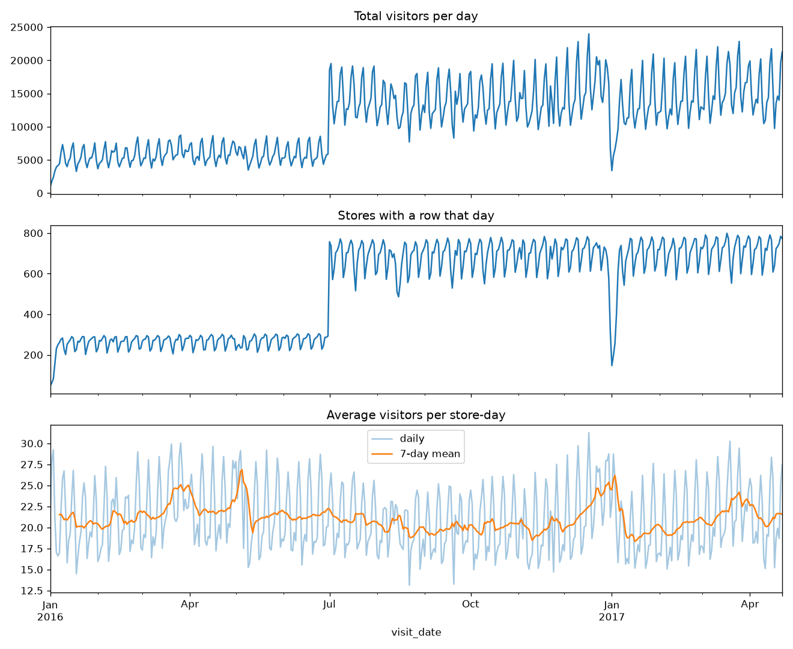
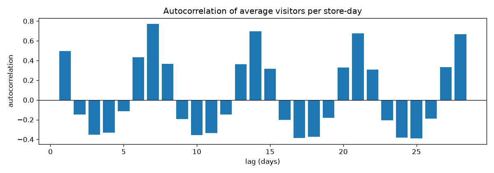

# Restaurant Visitor Forecasting

Forecast daily visitors for about 800 Japanese restaurants for the next 39 days, using the Recruit Restaurant Visitor Forecasting data from Kaggle.

## Problem
- **Task:** predict `visitors` for every restaurant and day in the test period
- **Horizon:** 39 days (2017-04-23 to 2017-05-31)
- **Metric:** RMSLE (also reported: MAE)
- **Validation:** the last 39 days of the training data, so the model is tested only on days it has not seen

## Data at a glance
| Item | Value |
|---|---|
| Training rows / stores | 252,108 rows, 829 stores |
| Training period | 2016-01-01 to 2017-04-22 |
| Test set | 39 days, 821 stores, 32,019 rows (2017-04-23 to 2017-05-31) |
| Missing store-days (inside each store's own span) | 44,171 (coverage 85.1%) |
| Visitors per store-day | median 17, mean 21.0, max 877 |

## What the exploratory analysis found
1. Weekday matters: relative to each store's own average, Saturday is the busiest day (1.27) and Monday the quietest (0.80).
2. Most missing rows look like closed days, not lost data: 279 stores are missing one weekday more than 80% of the time (mostly Sunday or Monday), and rows are missing 32.6% of the time on holidays versus 13.7% on normal days.
3. The jump in total visitors on 2016-07-01 comes from the data, not from demand: the number of stores with a row jumped from 293 to 757 while the average per store stayed flat.
4. There is a weekly pattern: the autocorrelation of average daily visitors is highest at lag 7 (0.77), then lag 14 (0.69). Because the horizon is 39 days, lag 7 alone is only known for the first week of the forecast.





## Repository layout
```text
src/forecast/   reusable code (data loading and validation)
tests/          unit tests
notebooks/      exploratory analysis on the real data
reports/        problem framing, data dictionary, feature ideas, figures
data/raw/       Kaggle files (not committed)
```

## Getting started
```bash
python -m venv .venv
.venv\Scripts\activate          # Windows
source .venv/bin/activate       # macOS / Linux
pip install -e ".[dev]"
python -m pytest
```
Download the Kaggle files into `data/raw/`.

## Planned work
- Baseline forecasts and a time-based validation
- Feature pipeline (calendar, holidays, store history)
- Gradient boosting with tuning and error analysis
- API, container and monitoring